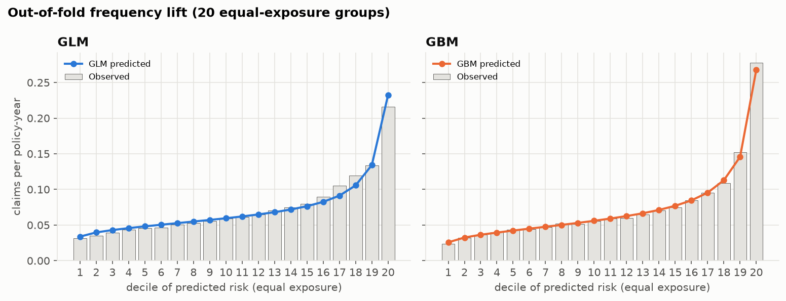
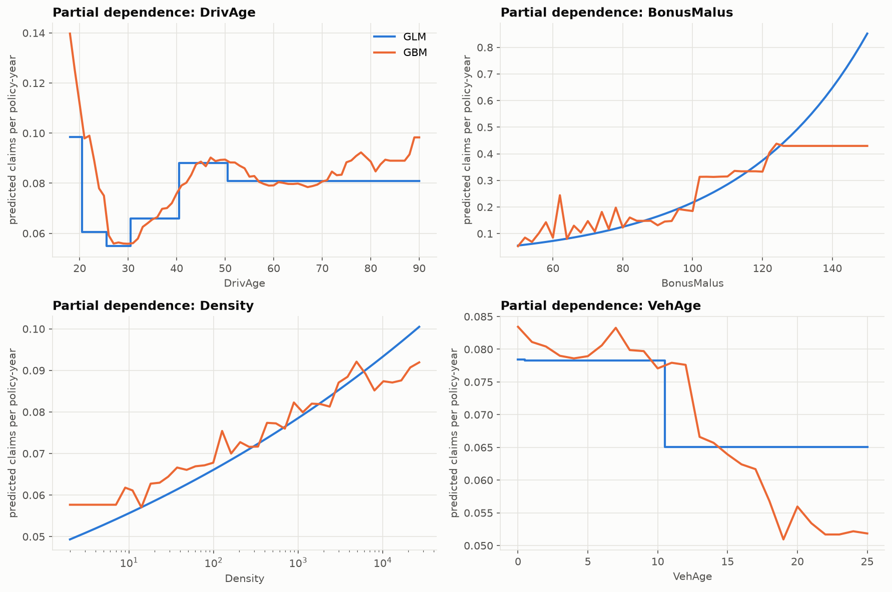

# Motor insurance pricing model

End-to-end **claim frequency and severity modelling** on the public French motor third-party
liability dataset **freMTPL2** (678,013 policies, 358k policy-years, 26k claims).

Actuarial **GLMs** (Poisson frequency, Gamma severity) are benchmarked against **gradient boosting
(LightGBM)** under **exposure-weighted cross-validation** with Poisson/Gamma deviance, Gini index and
lift curves. Pricing drivers are explained with **SHAP values** and **partial dependence plots**.
Everything is a reproducible, tested pipeline: a small Python package (`src/motor_pricing`) and six
fully documented Jupyter notebooks.

## Key results

Exposure-weighted, stratified 5-fold cross-validation on the full portfolio:

| | Poisson / Gamma GLM | LightGBM | GBM better? |
|---|---|---|---|
| **Frequency** - Poisson deviance | 0.4572 | **0.4468** | yes, 5/5 folds (paired t-test p < 0.0001) |
| Frequency - deviance explained | 4.4% | **6.5%** | yes |
| Frequency - Gini index | 0.282 | **0.330** | yes, 5/5 folds |
| **Severity** - deviance explained | 0.4% | 0.3% | no (p ≈ 0.6) |
| Severity - Gini index | 0.038 | 0.038 | no |
| **Pure premium** - Gini (capped cost) | 0.308 (GLM × GLM) | **0.349** (GBM × GBM) | yes, 5/5 folds |

* **Frequency is where segmentation happens.** The GBM ranks risks better and stays calibrated in the
  tails: its riskiest 5% of exposure has an observed frequency of 0.278 (predicted 0.268), 11× its
  safest 5%.
* **Severity is barely predictable** from rating factors (~0.3% of deviance). A parsimonious Gamma GLM
  (driver age + bonus-malus) is as good as the GBM, which over-fits high-cardinality categoricals.
* **Why the GBM wins** (SHAP interaction values): finer non-linear shapes and, above all, a
  **bonus-malus × driver age interaction** - a high bonus-malus is far less alarming for a 20-year-old
  (who simply has not earned bonus yet) than for a 50-year-old (who must have had recent claims).
  The GBM also isolates bonus-malus levels that reveal a recent claim (e.g. **62 = 50 × 1.25**).
* **Money:** in a simulated market where customers buy the cheaper price, the GLM-priced insurer
  suffers adverse selection with a **loss ratio of ~135-147%** against **~94-102%** for the GBM insurer.
* **Large losses** (> €100k, 0.16% of claims but ~18% of cost) are concentrated in the riskiest decile
  (15 of 41): a flat large-loss loading under-prices the riskiest customers.

| Frequency lift (out-of-fold) | SHAP: bonus-malus × age interaction |
|---|---|
|  |  |

| Partial dependence: GLM vs GBM | Double lift: GBM vs GLM (test set) |
|---|---|
|  |  |

## Notebooks

Run them in order; each one starts with its goal in plain words, explains the theory before every
method, and interprets every result both mathematically and in insurance terms.

| # | Notebook | Content |
|---|---|---|
| 01 | [Data ingestion and cleaning](notebooks/01_data_ingestion_and_cleaning.ipynb) | Download from OpenML, plain-language data dictionary, quality checks, freq/sev consistency fix, exposure and claim caps, large-claim capping, targets |
| 02 | [Exploratory data analysis](notebooks/02_exploratory_data_analysis.ipynb) | One-way frequency/severity with Poisson CIs, correlations (Spearman, Cramér's V), age × bonus-malus |
| 03 | [Frequency modelling](notebooks/03_frequency_modelling.ipynb) | Poisson GLM with exposure offset (relativities, over-dispersion) vs LightGBM (theory, CV tuning); deviance, Gini, Lorenz, lift, double lift |
| 04 | [Severity modelling](notebooks/04_severity_modelling.ipynb) | Gamma GLM (F-test factor selection) vs LightGBM (tree count by CV curves) |
| 05 | [Model comparison and pure premium](notebooks/05_model_comparison_and_pure_premium.ipynb) | Exposure-weighted 5-fold CV, paired tests, pure premium = freq × sev × large-loss loading, adverse-selection experiment |
| 06 | [Explainability](notebooks/06_explainability.ipynb) | SHAP importance, dependence and interaction values, GLM vs GBM partial dependence and ICE, local explanations |

## Data

**freMTPL2** comes from the R package [CASdatasets](https://github.com/dutangc/CASdatasets)
(Dutang & Charpentier) and is the standard benchmark of the actuarial literature (e.g. Noll, Salzmann &
Wüthrich, 2018). It is downloaded automatically from **OpenML** on the first run:

| Table | OpenML id | Rows | Content |
|---|---|---|---|
| `freMTPL2freq` | [41214](https://www.openml.org/d/41214) | 678,013 | one row per policy: exposure, claim count, 9 rating factors |
| `freMTPL2sev` | [41215](https://www.openml.org/d/41215) | 26,639 | one row per claim: amount |

The raw download is cached untouched in `data/raw/` (parquet) and the cleaned table in
`data/processed/`; neither is committed. Main cleaning decisions (justified in notebook 01):
claim counts recomputed from the claim table (≈9,100 policies, almost all with IDpol ≤ 25,000,
declare claims without any amount), exposure capped at 1 year, claim counts at 4, single claims capped
at €100,000 for severity modelling with the excess re-applied as a loading.

## Project structure

```
├── notebooks/                 # 01-06, executed, with outputs
├── src/motor_pricing/
│   ├── data.py                # OpenML ingestion, raw cache, cleaning, targets
│   ├── eda.py                 # one-way analysis with confidence intervals, Cramér's V
│   ├── features.py            # GLM binning / reference levels, LightGBM features
│   ├── models.py              # Null, Poisson & Gamma GLMs (statsmodels), LightGBM freq & sev
│   ├── metrics.py             # weighted deviances, Lorenz/Gini, lift, double lift
│   ├── validation.py          # stratified split, K-fold CV, scorers
│   ├── explain.py             # model-agnostic partial dependence and ICE
│   └── plotting.py            # consistent chart style and reusable charts
├── tests/                     # pytest suite on synthetic data (offline)
├── docs/images/               # figures used in this README
├── requirements.txt           # pinned versions
├── pyproject.toml
└── CLAUDE.md                  # conventions for contributors / AI assistants
```

## Reproduce

Requires Python 3.11+ (tested on 3.14, Windows 11). PowerShell:

```powershell
git clone https://github.com/mattrcc95/motor-insurance-pricing-model.git
cd motor-insurance-pricing-model
python -m venv .venv
.\.venv\Scripts\python.exe -m pip install -r requirements.txt
.\.venv\Scripts\python.exe -m pip install -e .
.\.venv\Scripts\python.exe -m ipykernel install --user --name motor-pricing --display-name "Python (motor-pricing)"

# tests (offline, a few seconds)
.\.venv\Scripts\python.exe -m pytest -q

# run the whole pipeline (internet needed once for the OpenML download; ~15 minutes)
Get-ChildItem notebooks\*.ipynb | Sort-Object Name | ForEach-Object {
  .\.venv\Scripts\jupyter.exe nbconvert --to notebook --execute --inplace `
    --ExecutePreprocessor.kernel_name=motor-pricing --ExecutePreprocessor.timeout=-1 $_.FullName
}

# or explore interactively
.\.venv\Scripts\jupyter.exe lab
```

On macOS/Linux use `.venv/bin/python` instead of `.\.venv\Scripts\python.exe`.
To activate the environment in a PowerShell terminal:
`Set-ExecutionPolicy -Scope Process RemoteSigned; .\.venv\Scripts\Activate.ps1`.

All random seeds are fixed (`motor_pricing.RANDOM_STATE = 42`); re-running the notebooks reproduces
the numbers above.

## Limitations and next steps

* GBM hyper-parameters were tuned on the training split that overlaps the CV folds (no nested CV);
  the tuning was shown to be insensitive, so the bias is negligible but not zero.
* The Poisson model is over-dispersed (Pearson φ ≈ 1.7): GLM standard errors are optimistic by ~30%.
* SHAP and partial dependence explain the model, not causal effects.
* Before production: monotonicity constraints in bonus-malus for the GBM, a separate large-loss
  model instead of a flat loading, re-balancing of the GBM pure premium, and a fairness review of
  proxy variables (region, brand).
* Alternative: enrich the GLM with the bonus-malus × age interaction found by SHAP to keep a fully
  transparent tariff.

## References

* Noll, A., Salzmann, R., Wüthrich, M. V. (2018). *Case Study: French Motor Third-Party Liability Claims*. SSRN 3164764.
* Dutang, C., Charpentier, A. *CASdatasets: Insurance datasets* (R package).
* Ohlsson, E., Johansson, B. (2010). *Non-Life Insurance Pricing with Generalized Linear Models*. Springer.
* Lundberg, S. M., Lee, S.-I. (2017). *A Unified Approach to Interpreting Model Predictions*. NeurIPS.
* Ke, G. et al. (2017). *LightGBM: A Highly Efficient Gradient Boosting Decision Tree*. NeurIPS.
