# Motor insurance pricing model

End-to-end claim frequency and severity modelling on the public French motor third-party liability
dataset **freMTPL2** (678,013 policies, ~358,000 policy-years, ~26,000 claims). Classical actuarial
GLMs are benchmarked against gradient boosting (LightGBM), and the pricing drivers are explained with
SHAP values and partial dependence plots. The work is presented in six documented Jupyter notebooks,
run in order.

## Steps and milestones

1. **Data ingestion (notebook 01)** - The two public tables (one row per policy, one row per claim) were
   downloaded automatically from OpenML, checked for schema changes and stored untouched, so the whole
   analysis can be rebuilt from scratch.

2. **Data cleaning (notebook 01)** - About 9,100 policies declared claims with no recorded cost, almost
   all in one block of policy numbers. Claim counts were recounted from the claim table so that frequency
   and severity describe the same events. Exposure was capped at one year and claim counts at four.

   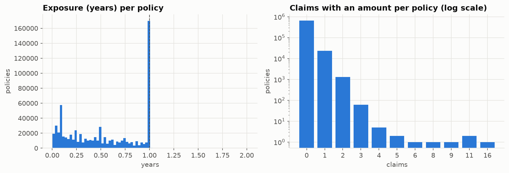
   *Left: years of cover per policy - most policies are observed for less than a year, a few beyond one
   year (errors, capped). Right: claims per policy on a log scale - 96% of policies have no claim.*

3. **Large-claim treatment (notebook 01)** - Claims above €100,000 are only 0.16% of claims but ~18% of
   total cost. They were capped for model training, and the excess was added back as a portfolio loading
   so that no money is lost from the final price.

   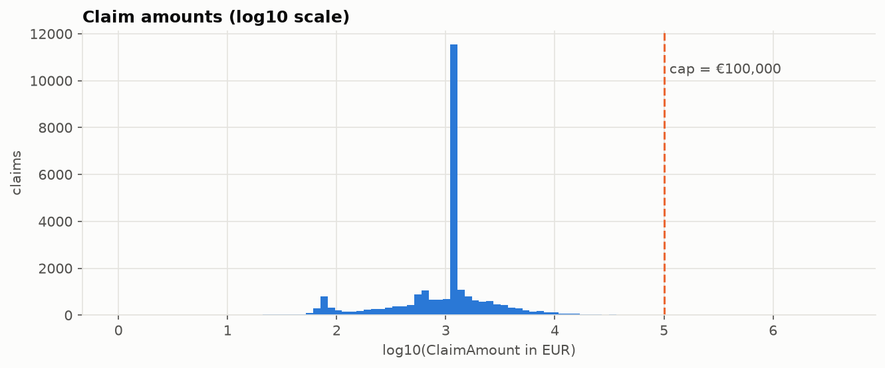
   *Claim amounts on a log scale: most claims cost around €1,000-1,200 (with a spike of flat-rate
   settlements), with a long tail up to €4 million. The dashed line is the €100,000 cap.*

4. **Exploratory analysis (notebook 02)** - One-way analyses with confidence intervals showed that
   bonus-malus, driver age and population density drive claim frequency, while claim cost varies little.
   `Area` was dropped because it duplicates `Density` (correlation 0.98), and an age × bonus-malus
   interaction was identified.

   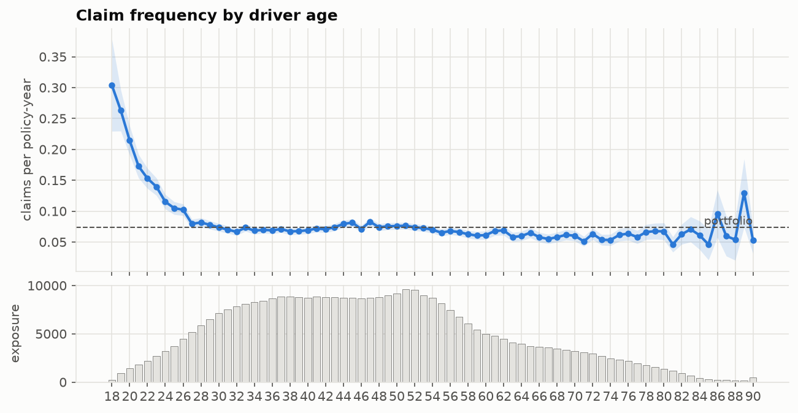
   *Claim frequency by driver age (band = 95% confidence interval; bars = exposure). An 18-year-old has
   about 4× the average frequency; the curve flattens from about 28.*

   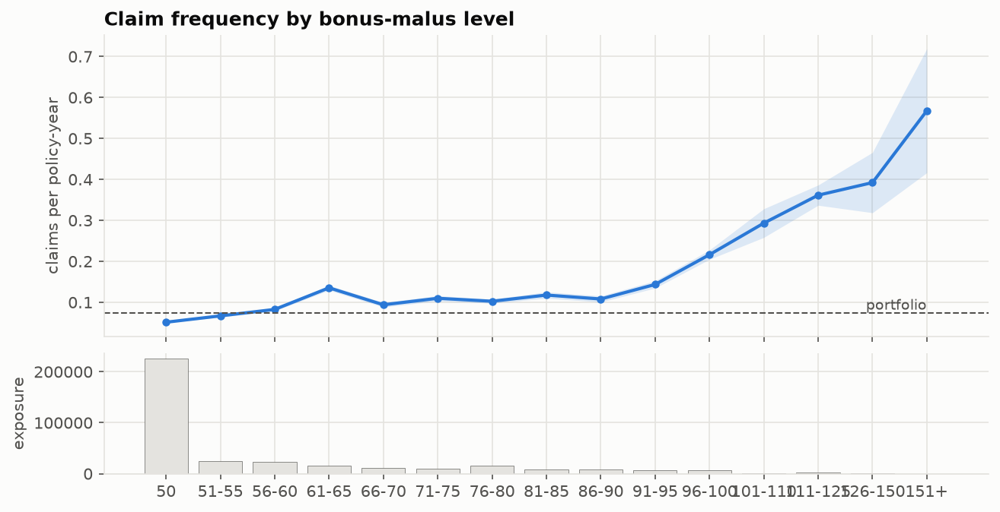
   *Claim frequency by bonus-malus level: from 0.7× the average at the maximum bonus (50) to 4-8× under
   malus (above 100).*

   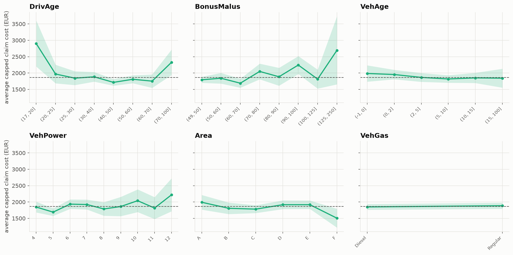
   *Average claim cost by factor: much flatter than frequency and with wide intervals - only very young
   and elderly drivers stand out.*

5. **Frequency modelling (notebook 03)** - A Poisson GLM with an exposure offset (the actuarial standard,
   read as multiplicative relativities) was compared with a LightGBM model using the same Poisson loss.
   On held-out data the GBM explained 6.1% of the deviance against 4.2%, and ranked risks better
   (Gini 0.320 vs 0.281).

   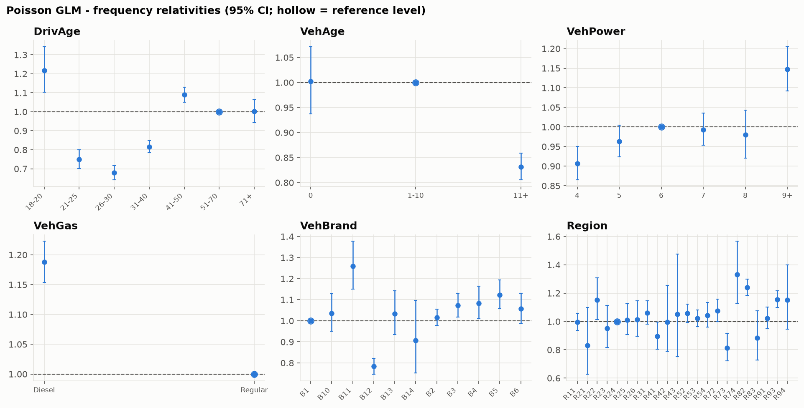
   *GLM relativities with 95% intervals (hollow dot = reference level = 1.0). Each value is a multiplier
   on the claim frequency, all other factors held fixed.*

   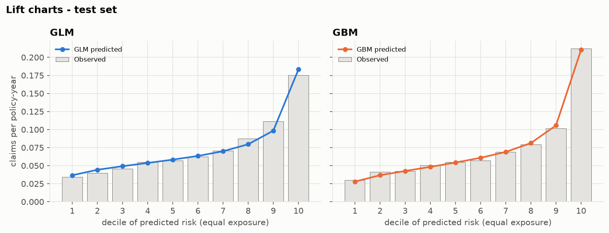
   *Lift charts on the test set: customers sorted into 10 equal-exposure groups by predicted risk. The
   GBM separates the safest and riskiest groups more (observed 0.030 → 0.212 vs 0.034 → 0.176) and stays
   on target.*

   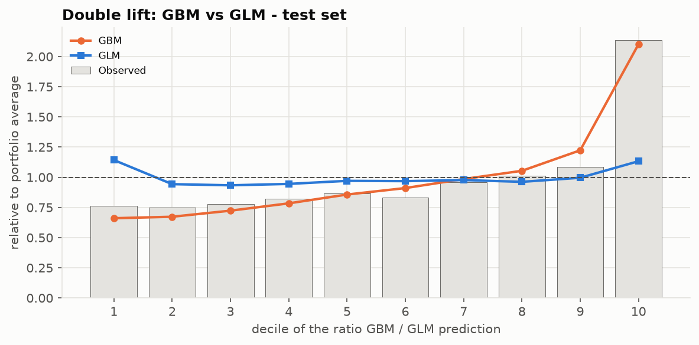
   *Double lift: customers sorted by how much the two models disagree. Where they disagree most (groups 1
   and 10), the observed frequency (bars) sides with the GBM - the GLM would under-price group 10 by
   almost half.*

6. **Severity modelling (notebook 04)** - A Gamma GLM was reduced to driver age and bonus-malus using
   statistical tests and cross-validation, then compared with a heavily regularised GBM. Claim cost turned
   out to be almost unpredictable from the rating factors (~1% of deviance), and the two models are tied.

   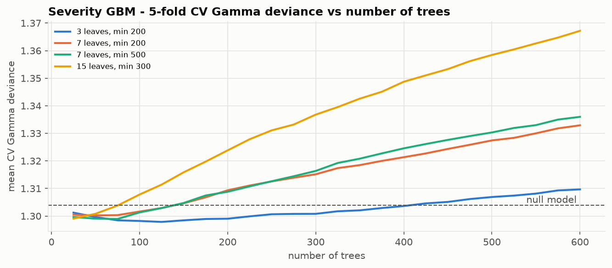
   *Cross-validated error of the severity GBM as trees are added: after a few dozen trees every extra
   tree makes it worse (over-fitting), and only the smallest trees stay below the no-model baseline
   (dashed).*

   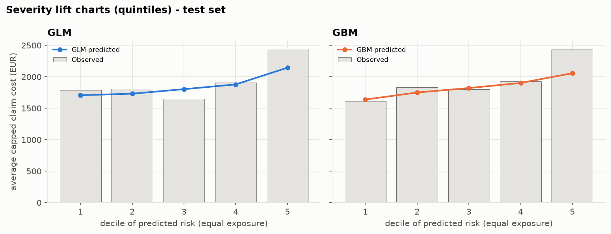
   *Severity lift charts (5 groups): both models can only isolate one more expensive group; the
   rest is flat.*

7. **Robust comparison (notebook 05)** - Exposure-weighted, stratified 5-fold cross-validation on the full
   portfolio confirmed the frequency result: the GBM is better in all five folds (Gini 0.330 vs 0.282;
   deviance explained 6.5% vs 4.4%), while for severity there is no significant difference.

   
   *Out-of-fold predictions for all 678k policies, in 20 equal-exposure groups: the GBM's riskiest
   group has 11× the frequency of its safest one (GLM: 7×), and its predictions track the observed
   values at both ends.*

8. **Pure premium (notebook 05)** - Frequency × severity × large-loss loading gives the expected annual
   cost per policy. The GBM-based tariff separates cheap and expensive customers better (Gini 0.349 vs
   0.308), and the best practical combination is GBM frequency with GLM severity.

   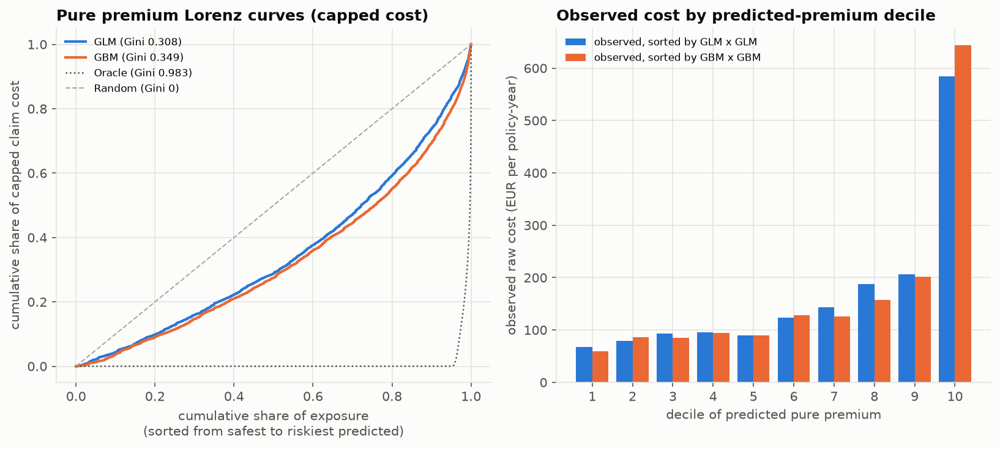
   *Left: Lorenz curves of the pure premium - the further below the diagonal, the better the ranking.
   Right: observed cost per policy-year in each decile of predicted premium: €60 → €644 with the GBM
   tariff, €68 → €584 with the GLM tariff.*

9. **Business impact (notebook 05)** - In a simulated market where customers buy the cheaper price, the
   GLM-priced insurer attracts the risks it under-prices (adverse selection) and reaches a loss ratio of
   ~135-147%, against ~94-102% for the GBM-priced insurer. Large claims also turned out to be concentrated
   among the riskiest customers (15 of the 41 claims above €100k fall in the riskiest 10%), so a flat
   loading under-prices them.

10. **Explainability (notebook 06)** - SHAP values show that the GBM relies on the same factors as the GLM,
    in the same order of importance. Its advantage comes from finer effect shapes and above all from the
    **bonus-malus × driver age interaction**: a high bonus-malus is far less alarming for a young driver
    than for an experienced one. Individual premiums can be broken down factor by factor, like a GLM tariff.

    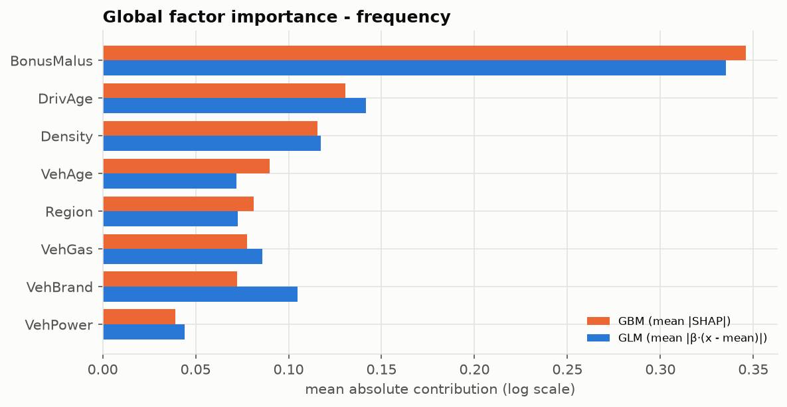
    *Average contribution of each factor to the predictions: same ranking for both models, with
    bonus-malus far ahead.*

    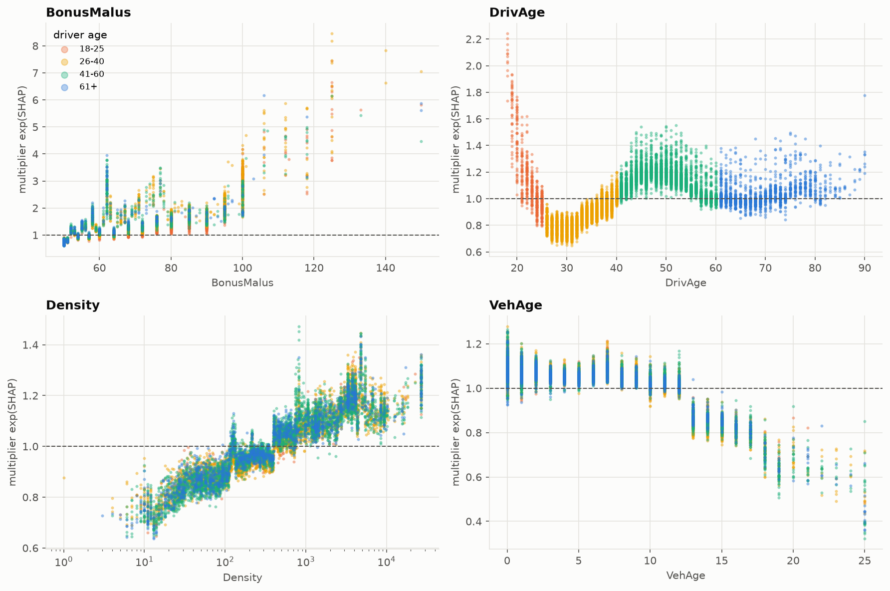
    *How each factor moves the GBM prediction (dots = policies, y = multiplier on frequency). Note the
    spike at bonus-malus 62 = 50 × 1.25: the level of a maximum-bonus driver who has just had a claim.*

    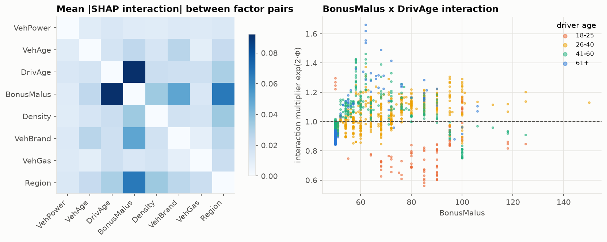
    *Left: strength of the interactions between factor pairs - bonus-malus × driver age dominates. Right:
    for young drivers (orange) a high bonus-malus is discounted (multiplier < 1), for experienced drivers it
    is loaded (> 1).*

    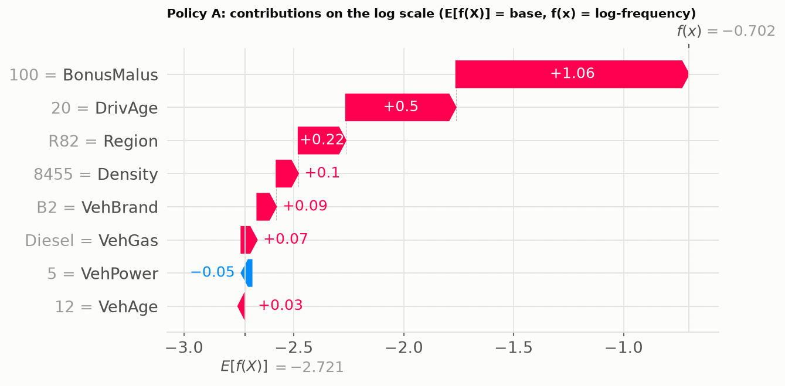
    *Why a 20-year-old driver with bonus-malus 100 in a dense city gets ~0.50 expected claims per year:
    each bar is one factor's contribution, adding up exactly to the prediction.*

11. **Reproducibility** - All random seeds are fixed. The full pipeline was re-run from a clean state
    (fresh download) and reproduced every result exactly.

## Data source

freMTPL2, from the R package CASdatasets (Dutang & Charpentier), mirrored on OpenML (datasets 41214 and
41215). Reference study: Noll, Salzmann & Wüthrich (2018), *Case Study: French Motor Third-Party Liability
Claims*.
